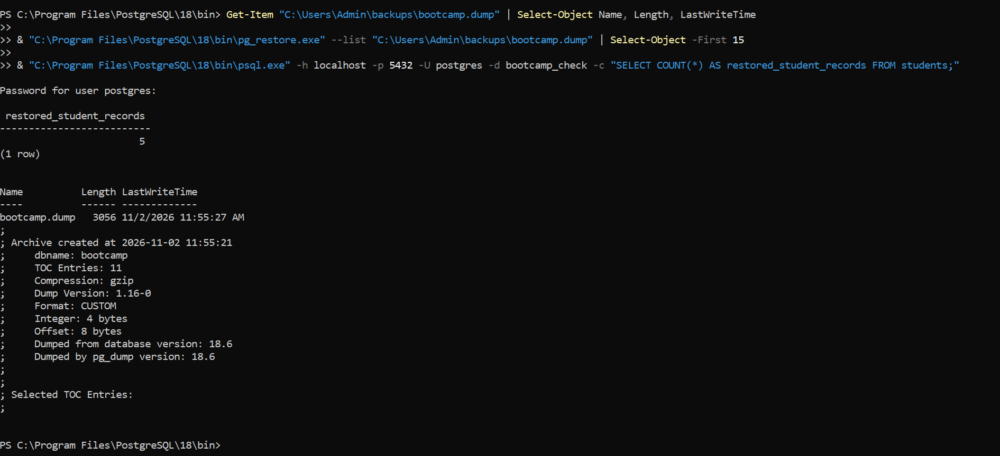
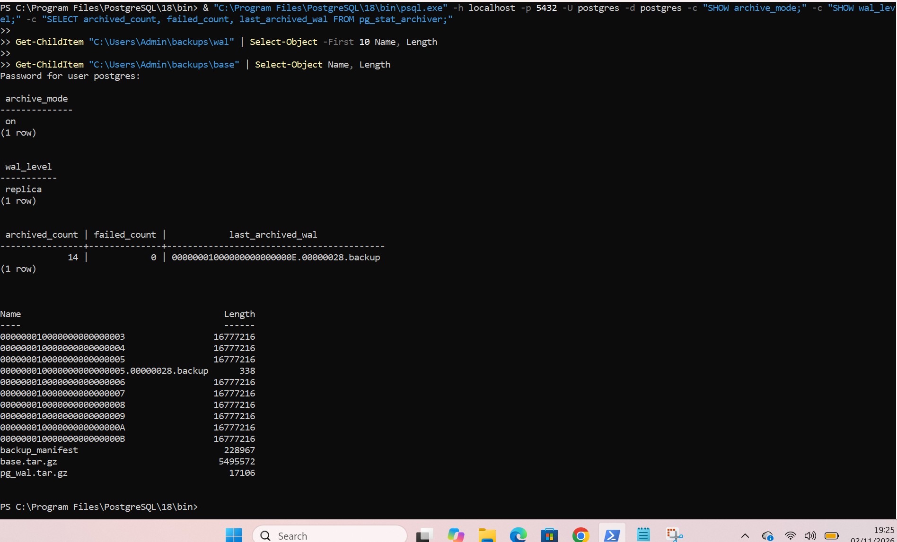
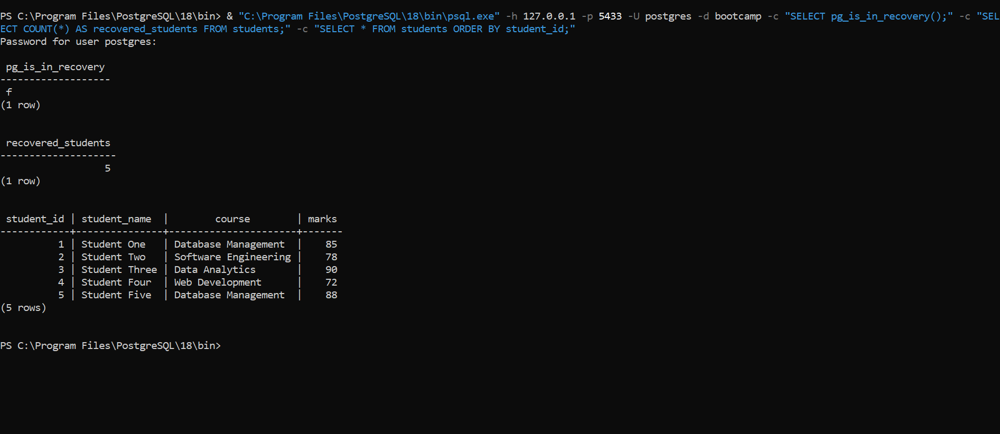
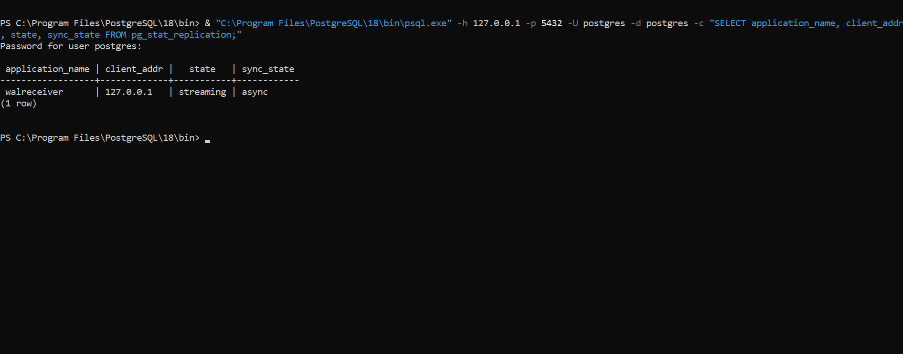
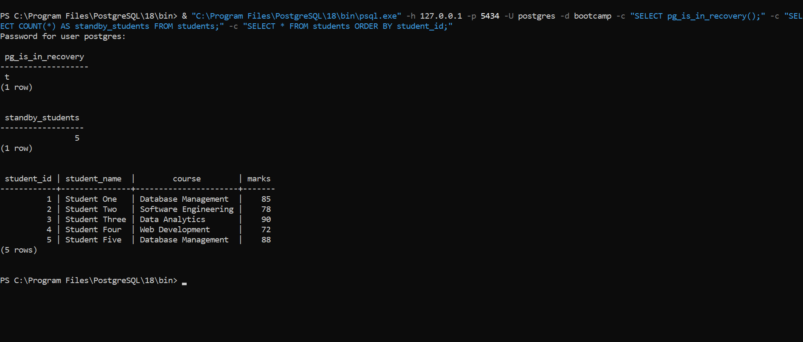

# PostgreSQL Hands-On Lab: Backups, Point-in-Time Recovery and Replication

## 1. Project Overview

This project demonstrates practical PostgreSQL database administration skills through logical backups, physical backups, Write-Ahead Logging (WAL) archiving, Point-in-Time Recovery (PITR), and streaming replication.

The lab was completed using PostgreSQL 18.6 on Windows.

### Objectives

- Create and restore a logical database backup.
- Configure WAL archiving.
- Create a physical base backup.
- Perform Point-in-Time Recovery (PITR).
- Configure streaming replication between a primary server and a standby server.
- Verify database recovery and replication using SQL queries.

## 2. Environment and Tools

| Component | Configuration |
|---|---|
| Database system | PostgreSQL 18.6 |
| Operating system | Windows 64-bit |
| Primary database | `bootcamp` |
| Primary server port | 5432 |
| PITR recovery server port | 5433 |
| Standby server port | 5434 |
| Backup utility | `pg_dump` |
| Restore utility | `pg_restore` |
| Physical backup utility | `pg_basebackup` |
| WAL inspection utility | `pg_waldump` |
| Administration tools | PowerShell and SQL |

## 3. Logical Backup and Restore

### Objective

Create a logical backup of the `bootcamp` database, inspect the backup, restore it into a separate database, and verify the restored records.

### Backup command

```powershell
pg_dump -U postgres -d bootcamp -F c -f "C:\Users\Admin\backups\bootcamp.dump"
```

The `-F c` option creates a custom-format backup.

### Inspect the backup

```powershell
pg_restore --list "C:\Users\Admin\backups\bootcamp.dump"
```

### Create a test database

```sql
CREATE DATABASE bootcamp_check;
```

### Restore the backup

```powershell
pg_restore -U postgres -d bootcamp_check --exit-on-error "C:\Users\Admin\backups\bootcamp.dump"
```

### Verification

The restored database was queried to confirm that the student records were available.

**Result:** Logical backup and restoration completed successfully. All five student records were verified in the restored database.

## 4. WAL Archiving and Physical Base Backup

### Objective

Configure PostgreSQL Write-Ahead Logging (WAL) archiving and create a physical base backup.

### PostgreSQL configuration

The following settings were configured in `postgresql.conf`:

```conf
wal_level = replica
archive_mode = on
archive_command = 'copy /Y "%p" "C:/Users/Admin/backups/wal/%f" >NUL'
```

The PostgreSQL service was restarted to apply the configuration.

### WAL archive directory

```text
C:\Users\Admin\backups\wal
```

### Physical base backup command

```powershell
pg_basebackup.exe -h localhost -p 5432 -U postgres -D "C:\Users\Admin\backups\base" -Ft -z -Xs -P
```

### Verification

The backup directory contained:

- `base.tar.gz` — physical database base backup.
- `pg_wal.tar.gz` — WAL files included with the backup.
- `backup_manifest` — backup verification manifest.

WAL archiving was also monitored using PostgreSQL's archiver statistics.

**Result:** WAL archiving and physical base backup completed successfully.

## 5. Point-in-Time Recovery (PITR)

### Objective

Recover the database to a specific time before an accidental deletion transaction.

### Recovery configuration

A separate recovery data directory was created:

```text
C:\Users\Admin\backups\pitr_recovery_data_corrected
```

The recovery configuration included:

```conf
port = 5433
listen_addresses = '127.0.0.1'
archive_mode = off
archive_command = ''
restore_command = 'C:/Users/Admin/backups/restore_wal.cmd "%f" "%p"'
recovery_target_time = '2026-11-02 13:42:40+03'
recovery_target_action = 'promote'
```

A `recovery.signal` file was created to initiate recovery.

### Recovery target explanation

During the first recovery attempt, the selected target time was after the deletion transaction had committed. WAL inspection showed that the deletion transaction committed at:

```text
2026-11-02 13:42:43.282373 EAT
```

The recovery target was therefore corrected to:

```text
2026-11-02 13:42:40 EAT
```

This target was before the deletion transaction committed.

### Verification

The recovered PostgreSQL instance was started on port `5433`.

The following query confirmed that the recovery server had been promoted:

```sql
SELECT pg_is_in_recovery();
```

The result was:

```text
false
```

The student records were checked using:

```sql
SELECT COUNT(*) FROM students;
```

The result was:

```text
5
```

The recovered records were also displayed using:

```sql
SELECT * FROM students ORDER BY student_id;
```

**Result:** Corrected Point-in-Time Recovery completed successfully, recovering all five student records from before the deletion transaction.

## 6. Streaming Replication

### Objective

Configure streaming replication between a primary PostgreSQL server and a standby server.

### Server configuration

| Server | Port | Purpose |
|---|---:|---|
| Primary PostgreSQL | 5432 | Main database server |
| PITR recovery instance | 5433 | Recovered database instance |
| Standby PostgreSQL | 5434 | Streaming replication standby |

### Create replication user

On the primary server, the replication role was created:

```sql
CREATE ROLE replicator WITH REPLICATION LOGIN;
```

A password was configured interactively.

### Configure client authentication

The following entry was added to `pg_hba.conf`:

```conf
host    replication    replicator    127.0.0.1/32    scram-sha-256
```

The PostgreSQL configuration was reloaded:

```sql
SELECT pg_reload_conf();
```

### Create the standby server

The standby data directory was created at:

```text
C:\Users\Admin\backups\standby_data
```

The following command initialized the standby:

```powershell
pg_basebackup.exe -h 127.0.0.1 -p 5432 -U replicator -D "C:\Users\Admin\backups\standby_data" -R -X stream -P
```

The `-R` option created the standby configuration, including the `standby.signal` file and connection information.

The standby was configured to use port `5434`.

### Start the standby server

```powershell
pg_ctl.exe -D "C:\Users\Admin\backups\standby_data" -l "C:\Users\Admin\backups\standby.log" start
```

### Verify standby recovery mode

On the standby server:

```sql
SELECT pg_is_in_recovery();
```

Expected result:

```text
true
```

### Verify replication on the primary

On the primary server:

```sql
SELECT application_name, client_addr, state, sync_state
FROM pg_stat_replication;
```

The connection showed:

| Application | Client address | State | Sync mode |
|---|---|---|---|
| walreceiver | 127.0.0.1 | streaming | async |

**Result:** Streaming replication was successfully established between the primary and standby servers.

## 7. Replication Testing

To confirm that changes on the primary server were replicated to the standby, a test table was created.

### Create and insert test data on the primary

```sql
CREATE TABLE IF NOT EXISTS replication_check (
    id INTEGER PRIMARY KEY,
    message TEXT
);

INSERT INTO replication_check (id, message)
VALUES (1, 'Streaming replication verified')
ON CONFLICT (id)
DO UPDATE SET message = EXCLUDED.message;
```

### Verify on the standby

```sql
SELECT * FROM replication_check;
```

The test record appeared on the standby server, confirming that replication was working.

The five student records were also restored on the primary and subsequently verified on the standby.

**Result:** Changes made on the primary server were successfully replicated to the standby server.

## 8. Final Lab Results

| Practical task | Result |
|---|---|
| Logical backup using `pg_dump` | Completed |
| Restore using `pg_restore` | Successful |
| WAL archiving configuration | Successful |
| Physical base backup | Successful |
| Point-in-Time Recovery | Successful |
| Replication role configuration | Successful |
| Standby server initialization | Successful |
| Streaming replication | Successful |
| Replication verification | Successful |
| Student record verification | 5 records confirmed |

## 9. Practical Evidence Screenshots

The following screenshots provide evidence of the practical work completed during the lab.

### 9.1 Logical Backup and Restore



### 9.2 WAL Archiving and Physical Base Backup



### 9.3 Point-in-Time Recovery



### 9.4 Streaming Replication Status



### 9.5 Standby Database Verification



## 10. Technologies and Tools Used

- PostgreSQL 18.6
- SQL
- PowerShell
- `pg_dump`
- `pg_restore`
- `pg_basebackup`
- `pg_waldump`
- PostgreSQL WAL archiving
- PostgreSQL Point-in-Time Recovery
- PostgreSQL streaming replication
- Git and GitHub

## 11. Security Considerations

For security reasons, this repository does not contain:

- Database passwords.
- PostgreSQL password files such as `pgpass.conf`.
- Private credentials or authentication tokens.
- Physical database backup archives.
- WAL archive files.
- Complete PostgreSQL data directories.

Only project documentation and selected practical evidence screenshots are included.

## 12. Conclusion

This hands-on lab provided practical experience in PostgreSQL database administration, backup and recovery procedures, and high-availability configuration.

The work demonstrated how to:

1. Create and restore logical database backups.
2. Configure WAL archiving and create physical backups.
3. Recover database records using Point-in-Time Recovery.
4. Configure a primary and standby PostgreSQL server.
5. Verify streaming replication and data consistency.

All four major practical objectives were completed successfully, and the results were verified using PostgreSQL commands and SQL queries.
